# REA Reverse Engineering Specification: Pollinations.ai Real Frontend Architecture
**Target Application:** Pollinations.ai (`https://pollinations.ai/`)  
**Investigation Framework:** Reverse Engineer Anything (REA v42 / Evidence Ledger Standard)  
**Evidence Source:** Live Shipped Bundles (`index-DscWxtve.js`, `index-D1APO1BX.css`, `HeroScene-B46oz1uo.js`, `publicStats-sj3x6__o.js`, `home_page.js`)  
**Classification:** Prototype Testing Specification (Strict Local Sandbox - No Upstream Push).

---

## 1. REA Shipped-Artifact Evidence Manifest

```yaml
evidence_records:
  - evidence_id: "ev_polli_fonts_001"
    authority: "shipped-artifact"
    confidence: "observed"
    predicate_type: "exact_typography_hierarchy"
    operation: "extract_css_font_faces"
    normalized_result:
      heading_display:
        family: "LCT Mogi"
        file: "/assets/lct-mogi-a-CXNX-res.woff2"
        role: "Primary brand display headings (bold retro-futuristic rounded geometry)"
      subheading_editorial:
        family: "Fraunces"
        file: "/assets/fraunces-soft-bold-DRtlyhoT.woff2"
        weight: 500
        role: "Editorial subheadings, h1 title phrases, and card titles"
      body_sans:
        family: "Uncut Sans"
        file: "/assets/uncut-sans-variable-DfydcN6x.woff2"
        weight: "300 700 variable"
        role: "Universal body, navigation, labels, and paragraph copy"
      pixel_monospace:
        family: "Geist Pixel Square"
        file: "/assets/geist-pixel-square-B0mEoKr8.woff2"
        role: "Micro tags, pill counters, seeds, and status labels"

  - evidence_id: "ev_polli_tokens_002"
    authority: "shipped-artifact"
    confidence: "observed"
    predicate_type: "design_system_tokens"
    operation: "extract_root_css_variables"
    normalized_result:
      color_space: "OKLCH with hue angle 85deg and nudge 0.024"
      brand_dark: "#110518" # Deep Plum Dark
      brand_accent: "oklch(calc(.876 + var(--polli-nudge)) .135 var(--polli-hue))" # Pollen Chartreuse / Golden Lime (#d4eb46)
      dark_mode:
        app_bg: "oklch(14.5% .004 80)" # Warm Charcoal (#1a1a19)
        surface_block: "oklch(20.5% .005 80)" # Inner Module Block (#242423)
        surface_opaque: "oklch(25.5% .006 80)" # Card Surface (#2e2e2d)
        surface_translucent: "oklch(25.5% .006 80 / 0.8)"
        surface_menu: "oklch(30% .006 80)"
        text_strong: "oklch(93% .004 80)" # #f0f0ee
        text_base: "oklch(85% .007 80)" # #d6d6d3
        text_muted: "oklch(72% .008 80)" # #b4b4b0
        divider: "oklch(35% .005 80)"
      light_mode:
        app_bg: "oklch(90.2% .013 80)" # Warm Stone Cream (#e7e4dc)
        surface_block: "oklch(.96 .02 85)"
        surface_opaque: "oklch(99.6% .004 85)"
        text_strong: "oklch(25% .02 80)"
      modality_colors:
        image: "oklch(62% .1 350)" # Soft Rose Berry
        video: "oklch(62% .1 190)" # Soft Cyan / Aqua
        audio: "oklch(62% .1 300)" # Soft Lavender Purple
        text: "oklch(62% .1 252)" # Soft Sky Blue
        realtime: "oklch(62% .1 128)" # Soft Meadow Lime
        embedding: "oklch(62% .1 163)" # Soft Mint
      radii:
        block_outer: "1.75rem" # 28px
        card_inner: "1.25rem" # 20px
        pills: "9999px"

  - evidence_id: "ev_polli_artwork_003"
    authority: "shipped-artifact"
    confidence: "observed"
    predicate_type: "hero_scene_architecture"
    operation: "analyze_HeroScene_module"
    normalized_result:
      hero_artwork_night: "/art/home-hero-night.webp"
      hero_artwork_day: "/art/home-hero-day.webp"
      hero_mask: "linear-gradient(90deg, #0000 38%, #000 62%), linear-gradient(#000 55%, #0000 100%)"
      hero_mask_composite: "intersect"
      closing_artwork: "/art/home-closing-night.webp"
      quests_artwork: "/art/home-quests-night.webp"
```

---

## 2. Visual Identity & Brand System

### 2.1 The Signature "Pollen Chartreuse" Accent
Unlike generic neon cyber aesthetics, Pollinations.ai uses an organic, vibrant **Pollen Chartreuse / Golden Lime** (`oklch(87.6% 0.135 85)` ≈ `#d4eb46` / `#d8eb42`) paired with a deep plum shadow tone (`#110518`).
- **Primary Buttons:** High-visibility pill shape with solid chartreuse fill `background: #d4eb46` and dark plum text `color: #110518; font-weight: 600`.
- **Primary Highlights:** Badges, pills, active links, and brand emblems use this chartreuse tone with soft 14% color-mix translucent backgrounds.

### 2.2 Typography Pairings
1. **Page Title / Main H1 (`LCT Mogi`):**
   - High-contrast, rounded retro-futuristic display font (`var(--polli-font-heading)`).
   - Letter-spacing: `-0.02em`, font-weight: `400` (intrinsically heavy display), line-height: `1.08`.
2. **Section Headings & Card Titles (`Fraunces`):**
   - Soft-bold editorial serif style with smooth organic terminals (`var(--polli-font-subheading)`).
   - Letter-spacing: `-0.015em`, font-weight: `700`, line-height: `1.15`.
3. **Body & Interface (`Uncut Sans`):**
   - Clean neo-grotesque sans with warm proportions and spacious line heights (`1.6`).
4. **Labels, Badges & Microtags (`Geist Pixel Square`):**
   - Retro-pixel monospace aesthetic for status pills, star counts, and tags.

### 2.3 Shipped Button System & Interactive Micro-Interactions
1. **Primary Hero Pill (`polli-btn-primary` / `btn-brand-accent`):**
   - Background: `oklch(87.6% 0.135 85)` (`#d4eb46`), Text: `#110518` (deep plum), `font-weight: 700`.
   - Dimensions: `min-height: 3rem` (48px), `padding: 0.75rem 1.625rem`, `border-radius: 9999px`.
   - Hover state: `filter: brightness(1.05); transform: translateY(-1px)`.
2. **Secondary Neutral Pill (`polli-btn-neutral` / `btn-neutral-pill`):**
   - Background: `oklch(25.5% .006 80)` (`#2e2e2d`), Text: `#f0f0ee`, border: `1px solid rgba(255, 255, 255, 0.08)`.
   - Dimensions: `min-height: 2.375rem`, `padding: 0.4rem 1.125rem`, `border-radius: 9999px`.
3. **Surface Pill (`btn-surface-pill`):**
   - Used for Account / Sign-in in header right: `bg-surface-opaque text-theme-text-strong rounded-full min-h-9 px-4`.
4. **Navigation Pill (`site-home-nav-button`):**
   - Active: `background: #d4eb46; color: #110518; font-weight: 700; border-radius: 9999px`.
   - Inactive: `background: transparent; color: #f0f0ee; font-weight: 700; border-radius: 9999px`.
   - Inactive Hover: `background-color: color-mix(in oklab, #d4eb46 60%, transparent); color: #110518`.
   - **Signature Logo Hover Linkage**: Hovering the logo lights up the active nav button; hovering the nav button nudges the logo upward.
5. **In-Text Action Link (`polli-link`):**
   - `color: var(--polli-color-text-soft)`, `text-underline-offset: 2px`, `font-weight: 500`.

### 2.4 Layered Masked Artworks (`HeroScene`)
The defining visual element of the Pollinations homepage is the top-right responsive generative illustration:
```css
.hero-scene {
  position: absolute;
  top: 0;
  right: 0;
  width: 60%;
  max-width: 1440px;
  object-fit: cover;
  pointer-events: none;
  -webkit-mask-image: linear-gradient(90deg, transparent 38%, #000 62%), linear-gradient(#000 55%, transparent 100%);
  mask-image: linear-gradient(90deg, transparent 38%, #000 62%), linear-gradient(#000 55%, transparent 100%);
  -webkit-mask-composite: source-in;
  mask-composite: intersect;
}
```

---

## 3. Structural Decomposition & Layout Hierarchy

```mermaid
graph TD
    Root["AppRoot ('body.dark')"] --> Header["SiteHeader ('fixed / sticky top-0')"]
    Root --> HeroScene["HeroScene ('Container with night artwork')"]
    Root --> MainGrid["ModularBlockGrid ('1.75rem rounded blocks')"]
    Root --> QuestsBanner["QuestsCreditsPanel ('1 pollen = $1')"]
    Root --> ClosingScene["ClosingArtworkScene ('home-closing-night.webp')"]
    Root --> Footer["SiteFooter ('Minimalist links')"]

    Header --> LogoMark["BrandMark ('Geometric SVG Emblem')"]
    Header --> NavGroup["NavPills ('Hello | Play | Apps | Community | Docs')"]
    Header --> Counters["BadgeCounters ('Discord Online | GitHub Stars')"]
    Header --> HeaderCTA["ConnectBtn ('Sign in / Account')"]

    HeroScene --> Eyebrow["EyebrowBadge ('Open infrastructure for AI-natives')"]
    HeroScene --> Heading["LCTMogiTitle ('Models. Agents. Tools. One API.')"]
    HeroScene --> Subtitle["UncutSansSubtitle ('The AI-native builder community...')"]
    HeroScene --> CTACluster["ActionCluster ('Pollen Lime Primary Button')"]
    HeroScene --> LiveCounter["RequestsCounter ('X,XXX requests in the last hour')"]
    HeroScene --> MaskedArtwork["ArtImg ('home-hero-night.webp with mask')"]

    MainGrid --> ModalitiesGrid["ModalitiesCategoryGrid ('Image | Text | Audio | Video | Realtime')"]
    MainGrid --> FeatureGrid["FeatureBlocksGrid ('Agents | Sandboxes | MCP | CLI...')"]
    MainGrid --> BenchmarkCard["FeaturedSplitCard ('Sony Benchmark / Quests')"]
    MainGrid --> CTABlock["ClosingActionPanel ('Start with one piece')"]
```



---

## 4. Exact Implementation Guidelines for PennyWise

To apply this verified design to PennyWise:
1. **Host the Verified Font Files:**
   - Link `Fraunces` via Google Fonts or serve directly from `assets/fonts/fraunces.woff2`.
   - Serve `Uncut Sans` from `assets/fonts/uncut-sans.woff2`.
   - Serve `LCT Mogi` and `Geist Pixel Square` from `assets/fonts/`.
2. **Apply Verified OKLCH Theme Variables:**
   - App Background: `oklch(14.5% .004 80)` (`#1a1a19`).
   - Brand Accent: `#d4eb46` (Pollen Lime) with `#110518` text for primary buttons.
   - Surface Blocks: `oklch(20.5% .005 80)` (`#242423`) with `1.75rem` (28px) radius.
   - Surface Cards: `oklch(25.5% .006 80)` (`#2e2e2d`) with `1.25rem` (20px) radius.
3. **Incorporate Real HeroScene Artwork:**
   - Integrate `assets/art/home-hero-night.webp` on top right with dual gradient masks.
   - Integrate `assets/art/home-closing-night.webp` at the bottom before footer.
4. **Header Architecture:**
   - Dissolve mask header, Pollinations SVG mark, nav links ("Hello", "Live Search", "Trending Deals", "Tickets", "About"), GitHub stars, Discord online pill with pulsing beacon dot, and surface account button (`btn-surface-pill`), keeping the primary chartreuse buttons (`btn-brand-accent`) reserved for main CTAs.
5. **Preserve PennyWise Integrity:**
   - Retain all PennyWise product pricing, store scraping data, Sony headphones comparison table, search actions, and tickets logic, wrapped seamlessly in this exact Pollinations.ai aesthetic.

---
*Derived via direct extraction from shipped Pollinations.ai production assets (REA v42 Evidence Ledger).*
